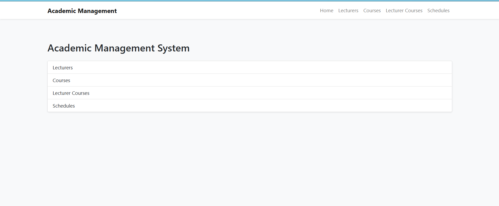

# Desain Program
Program ini dikembangkan menggunakan konsep Model-Viw-Controller(MVC) di mana arsitektur memisahkan beberapa tanggung jawab seperti pengelolaan data, proses aplikasi, dan tampilan antarmuka menjadi beberapa file agar program lebih terstruktur dan mudah untuk dikelola. Berikut struktur direktori dan fungsi masing-masing bagiannya:
1. View (app/view): berisi file-file tampilan antarmuka aplikasi yang digunakan untuk menampilkan data dan formulir CRUD. View dibagi menjadi 4 entitas yaitu lecturers, course, lecturer_course, dan schedule. Folder layout digunakan untuk menyimpan komponen tampilan yang digunakan bersama seperti navbar.
2. Controller (app/view): berisi file yang mengatur alur proses aplikasi. Controller menerima dan memproses permintaan pengguna, menghubungkan model dengan view serta menentukan proses crud yang dijalankan.
3. Model (app/view): Berisi file yang bertanggung jawab terhadap pengelolaan data dan komunikasi dengan database MySQL. Setiap model mewakili entitas yang dikelola aplikasi, yaitu Lecturers, Course, LecturerCourse, Schedule.
4. Database(database/): direktori untuk menyimpan berkas yang berkaitan dengan database.
5. Config(config/): berisi konfigurais aplikasi, termasuk database.php yang digunakan untuk mengatur koneksi ke database MySQL.
6. Public (public/): direktori utama yang menjadi akses aplikasi melalui browser, berisi file index.php, create.php, edit.php, dan delete.php untuk menangani permintaan CRUD, serta folder assets yang menyimpan file CSS dan JavaScript Bootsrap.

# Penjelasan Alur
Secara garis besar, alur program ini menggunakan konsep MVC dengan tahapan berikut:
1. User melakukan interaksi melalui browser, seperti melihat data yang tersedia, menambahkan, mengubah, atau menghapus data.
2. Public menerima permintaan pengguna melalui file yang terdapat pada direktori public/ kemudian diarahkan sesuai entitas dan operasi CRUS yang dipilih
3. Controller memproses permintaan dan menentukan tindakan yang perlu dilakukan dengan memanggil model
4. Model menjalankan proses pengolahan data, seperti mengambil, menyimpan, memperbarui, atau menghapus data pada database.
5. Database MySQL menyimpan data dan memberikan hasil sesuai permintaan model
6. Hasil pengolahan data tersebut diteruskan oleh Controller untuk ditampilkan melalui View
7. View menampilkan hasil proses kepada pengguna melalui browser.

# Dokumentasi

### 1. Home

### 2. Lecturers

**Data Awal Lecturers**

**Add Lecturer**

**Setelah Add Lecturer**

**Edit Lecturer**

**Setelah Edit Lecturer**

**Konfirmasi Hapus Data Lecturer**

**Setelah Hapus Lecturer**

### 3. Courses

**Data Awal Course**

**Add Course**

**Setelah Add Course**

**Edit Course**

**Setelah Edit Course**

**Konfirmasi Hapus Data Course**

**Setelah Hapus Course**

### 4. Lecturer Courses

**Data Awal Lecturer Course**

**Add Lecturer Course**

**Setelah Add Lecturer Course**

**Edit Lecturer Course**

**Setelah Edit Lecturer Course**

**Konfirmasi Hapus Lecturer Course**

**Setelah Hapus Lecturer Course**

### 5. Schedules

**Data Awal Schedule**

**Add Schedule**

**Setelah Add Schedule**

**Edit Schedule**

**Setelah Edit Schedule**

**Konfirmasi Hapus Schedule**

**Setelah Hapus Schedule**

